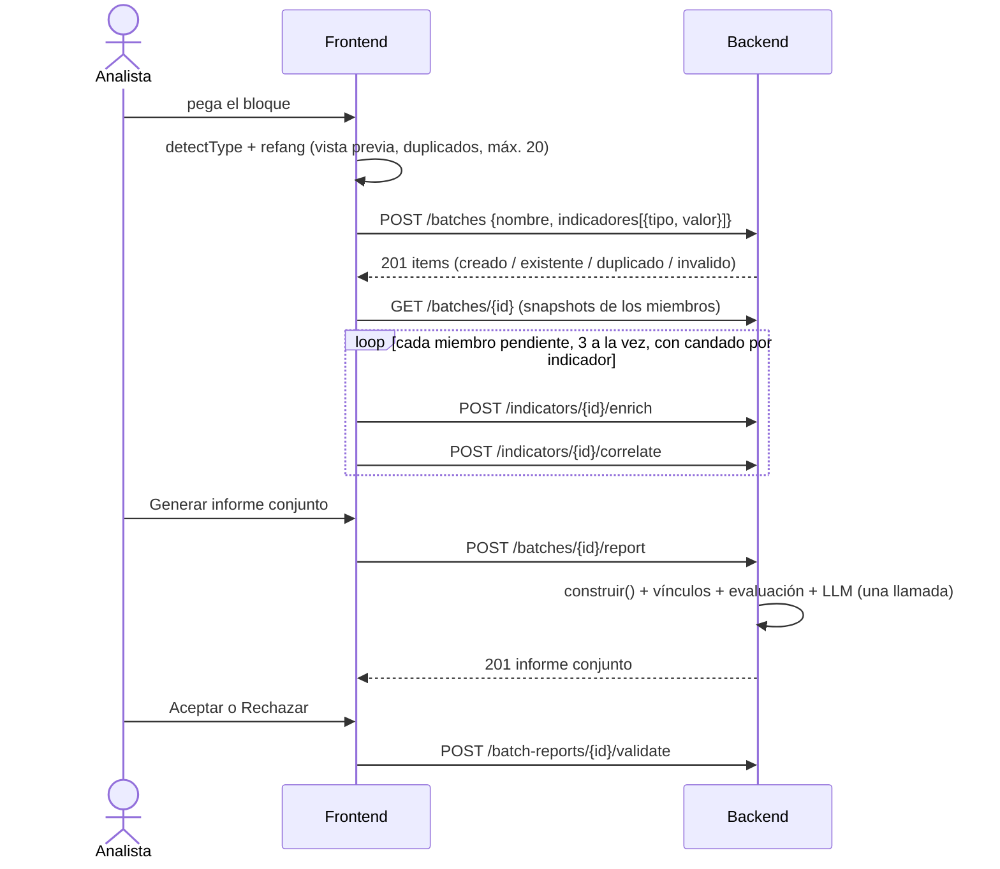

# Fase 7 — Análisis por lote de indicadores ("campañas"): diagnóstico, diseño y plan

Fecha: 2026-10-10. Estado: **propuesta pendiente de aprobación**. En este paso no se escribió
código, no se crearon migraciones y no se instalaron dependencias.

Repos: `nexo-intel-backend` (fases 7a–7c) y `nexo-intel-frontend` (7d–7e). La 7f es opcional y
toca los dos.

## 0. Resumen

- **Qué hace:** el analista pega un bloque de IoCs. NEXO registra o reutiliza cada uno, lo pasa
  por el pipeline actual, calcula vínculos determinísticos entre los indicadores y genera un
  **informe conjunto** que el analista acepta o rechaza.
- **Nombre:** **lote** (`batches` en la BD y en la API; "Lote" e "Informe conjunto" en la UI).
  "Campaña" queda reservado para el objeto *Campaign* de ATT&CK.
- **Orquestación híbrida, opción (a):** el backend registra el lote en una transacción y lo
  agrega en una sola lectura. El frontend corre `enrich → correlate` en cada indicador con los
  candados de `pipelineActions`, tres a la vez. No se genera el informe individual de cada
  indicador: el lote hace **una sola llamada al LLM**.
- **Vínculos:** se usan tres señales. Dos son fuertes: un pulse enfocado de OTX compartido y la
  misma infraestructura. La tercera es de contexto: la misma entidad atribuida. Solo las fuertes
  forman agrupaciones. Compartir técnicas o tácticas nunca cuenta como señal.
- **Límite:** 20 indicadores por lote. La cantidad de sentencias SQL de cada endpoint del lote
  no depende de N.
- **MVP:** fases 7a a 7e. Si falta tiempo, lo primero que se recorta es la 7f y lo último, el
  análisis de IA del lote.

---

## 1. Diagnóstico

### 1.1 Qué se revisó

- **Backend:** `app/db/models.py` y las dos migraciones (`aa1144a4839f`, `b3f1c2d4e5a6`), los
  cinco routers de `app/api/`, `enrichment/service.py` y los tres proveedores,
  `correlation/{service,attck_loader}.py`, `reporting/{service,severity,template,investigaciones}.py`,
  `ai_component/{service,prompt_builder,schema,llm_client,vectorstore}.py`, los repositorios,
  `ingestion/validators.py`, `normalization/normalizer.py`, `tests/{conftest,test_e2e_scenarios,test_consultas}.py`,
  `data/test_dataset/scenarios.json` y los informes de las fases 00 a 06.
- **Frontend:** `api/{http,nexo,types}.ts`; `state/{pipelineActions,investigations,storage,InvestigationsProvider}`;
  `domain/{investigation,format,attck,severity,confidence}.ts`; `hooks/useRoute.ts`; `App.tsx`;
  `components/case/{CaseDetail,ValidationPanel,AiAnalysisPanel,ReportPanel,AttackPanel}`;
  `sidebar/IndicatorForm.tsx` y `layout/SideNav.tsx`.
- **Presentación:** `docs/presentacion/guion.md` (diapositiva 8) y `casos-demo.md`.

### 1.2 Qué se confirma y qué se corrige del estado descrito

| Afirmación | ¿Correcta? | Matiz o corrección |
|---|---|---|
| El pipeline por indicador está completo | Sí | `/report` **no exige `/correlate`**: exige `/enrich` (si falta, 400) y vuelve a correlacionar, lo cual es idempotente (`reporting/service.py:21`). El frontend lo refleja: en `PIPELINE_STEPS`, `report.requires = 'enrich'`. |
| `/enrich` consulta en paralelo, con caché y estado por fuente | Sí | La caché **no vence** y no tiene restricción única `(indicator_id, fuente_api)` (D7, anotado con `ponytail:` en `repositories/enrichment_cache.py`). Un indicador reutilizado trae la evidencia de la fecha en que se consultó. |
| La correlación tiene dos etapas y se abstiene | Sí | — |
| Severidad y confianza son determinísticas; el LLM cita IDs y sus citas se depuran | Sí | `depurar` (`ai_component/schema.py:55`) exige que un hallazgo de tipo "evidencia" cite un bloque `E-*`. Sirve sin cambios para el lote si los bloques nuevos empiezan con `E-`. |
| Existe `POST /reports/{id}/validate` | Sí | `analista` siempre es NULL porque no hay login. |
| Existen los tres GET de solo lectura | Sí | También existen `DELETE /indicators/{id}`, que borra en cascada desde la aplicación (`repositories/indicator.py:27`), y `GET /status`. Por el DELETE, **cualquier tabla nueva que referencie `indicators` obliga a tocar esa cascada**. |
| La correlación es costosa contra Supabase | Ya no tanto | El N+1 de la Fase 0 (552 consultas para Lazarus, unos 41 s) se eliminó: `_persistir_tecnicas` hace 2 SELECT y 1 flush. Según el código, `/correlate` ejecuta unas 7–12 sentencias, alrededor de 0,5–1 s con el RTT de 75 ms medido en la Fase 0. Hoy lo caro por indicador es `/enrich`, que depende de la red (OTX puede tardar ~20 s en el peor caso), y el LLM (el plan gratuito de Groq da 1.000 tokens de salida por minuto, según la Fase 4). **Son estimaciones; se miden en la 7a.** |
| Los escenarios 3 y 4 quedaron "Parcial" | Sí | Lo confirma `guion.md`, diapositiva 8. Hay un detalle: `test_escenario_3/4` ya comprueban las propiedades conjuntas (al menos 5 tácticas; misma `entity.id` y técnicas comunes), pero las calcula el propio test. Lo que falta es el producto —agrupar y emitir el informe conjunto—, no corregir la correlación. |
| La demo corre sobre Supabase | No necesariamente | `casos-demo.md` usa un Postgres local (`nexo_demo`). El RTT de 75 ms aplica solo a Supabase. |

### 1.3 Qué existe y se puede reutilizar

| Pieza | Dónde | Uso en el lote |
|---|---|---|
| `IndicatorCreate` (normaliza y valida) | `schemas/indicator.py` | Valida cada ítem sin abortar el lote |
| `indicators.valor` único y `get_by_valor` | `models.py`, `repositories/indicator.py` | Reutiliza el indicador existente en lugar de devolver 409; un solo `SELECT … IN` para todo el lote |
| `construir()` | `reporting/investigaciones.py:43` | Arma el snapshot de N indicadores con 5 consultas. Ya trae los pulses de OTX recortados, con `id` e `indicator_count` |
| `correlation_from_link` | `correlation/service.py:193` | Correlación de cada miembro sin escribir en la BD |
| `calcular_severidad`, `calcular_concordancia`, `detectar_contradicciones`, `calcular_confianza`, `cobertura` | `reporting/severity.py`, `enrichment/service.py` | Evalúa cada indicador con el mismo criterio que `/report` |
| `MAX_INDICADORES_PULSE` | `correlation/service.py:28` | Mismo filtro de volcados para la señal de pulse compartido |
| `generate_analysis`, `parsear`, `depurar` y la forma del registro `ia` | `ai_component/` | Análisis del lote sin código de validación nuevo |
| `seleccionar_tecnicas`, `_cuerpo` y `renderizar_prompt` (con las reglas como parámetro) | `ai_component/prompt_builder.py` | Contexto del lote |
| `HumanValidationRequest` | `schemas/human_validation.py` | Cuerpo de la validación del lote |
| `Ventana` de VirusTotal | `providers/base.py:125`, `virustotal.py:16` | Sigue siendo el único control de cupo |
| Infraestructura de tests: `conftest` (sin LLM ni fuentes reales, índice sintético), `scenarios.json` (escenarios 3 y 4 congelados) y el conteo de sentencias de `test_consultas.py` | `tests/` | Pruebas de la feature |
| `detectType` y `DEFANG` | front `domain/format.ts:54` | Parseo del bloque pegado |
| Candados por indicador, `runAutomatic`, `runStep`, `describeFailure` y las acciones `loaded`/`registered` del reducer | front `state/` | Orquestación y progreso |
| `groupByTactic` (orden ATT&CK 19.1) | front `domain/attck.ts` | Cobertura conjunta de la cadena de ataque |
| `Panel`, `Tabs`, `Badge`, `Alert`, `EmptyState`, `ConfirmDialog`, `SourceChips`, `SeverityBadge`, `sourceCoverage` | front `components/` | Pantallas del lote |
| Cuerpo de `AiAnalysisPanel`, `ValidationPanel` y el render Markdown de `ReportPanel` | front `components/case/` | Hay que desacoplarlos de `Investigation` para reutilizarlos |
| `fakeBackend` y `fixtures` | front `src/test/` | Pruebas sin red |

### 1.4 Qué falta

- Un **lote persistido** que guarde lo que pegó el analista, en orden y con los descartes.
- Ingesta en bloque con un resultado por ítem (`creado`, `existente`, `duplicado`, `invalido`)
  en una sola transacción.
- Correlación **entre** indicadores: señales, vínculos por par, agrupaciones, conclusión y
  cobertura.
- El informe conjunto (Markdown y metadatos), con su contexto y su prompt para el LLM.
- La validación del informe conjunto, con historial.
- En la UI: ingreso en bloque con vista previa, orquestación con progreso, lista de lotes y
  detalle.
- El backend **no detecta el tipo** de un IoC: lo envía el cliente, y el frontend ya sabe
  detectarlo.

### 1.5 Deuda y riesgos que afectan la feature

| # | Riesgo | Evidencia | Qué hace el plan |
|---|---|---|---|
| R1 | Cupo de VirusTotal de 4/min, en memoria y por proceso; la API pública tiene además un cupo diario | `virustotal.py:16`, `base.py:125` | Estrategia de la §2.7 |
| R2 | La caché no vence: un indicador reutilizado aporta evidencia vieja | D7 | El informe marca `ingesta: existente` y la fecha de registro. Volver a consultar queda fuera de alcance |
| R3 | `techniques.tactica` guarda solo la primera fase ATT&CK (195 de 697 técnicas tienen más de una) | `attck_loader.py::_tactica` | La cobertura conjunta lo declara como límite; no se corrige en esta fase |
| R4 | "Reintentar fuentes" solo re-enriquece, y la fusión monotónica conserva la correlación local vieja | `CaseDetail.tsx:241`, `investigations.ts:85` | "Completar fuentes" del lote encadena `enrich → correlate`, y el lote se calcula en el backend, que es la fuente de verdad |
| R5 | `sync` recorre todas las investigaciones al arrancar; cada lote suma hasta 20 | `pipelineActions.ts` (`ponytail:`) | Límite de 20. La carga bajo demanda queda fuera |
| R6 | El refang del backend distingue mayúsculas (`HXXP://` y `[DOT]` no se deshacen) y `detectType` no: un bloque en mayúsculas daría 422 | `normalizer.py:13`, `format.ts` | Corrección de una línea en la 7a |
| R7 | Tamaño del prompt: el `num_ctx` de Ollama trunca por el principio y Groq limita los tokens de salida por minuto | `prompt_builder.py` (`MAX_TECNICAS`), Fase 4 | Topes del contexto (§2.9) y una sola llamada por lote |
| R8 | `remark-gfm` convierte las URL en enlaces que se abren en otra pestaña, así que un IoC de tipo URL en el Markdown queda como enlace clicable a infraestructura maliciosa | `ReportPanel.tsx:23`, `template.py` (`# Informe de indicador: {valor}`) | En el informe conjunto los valores van entre comillas invertidas (`código`), que no se autoenlazan. El informe individual tiene el mismo problema: se reporta, pero queda fuera de alcance |
| R9 | OTX puede listar menos pulses que su `count`, y los no listados no se comparan | `providers/otx.py::resumir` | Se declara como posible falso negativo en las limitaciones |
| R10 | Los nombres de pulses son texto libre de terceros | docstring de `prompt_builder.py` | Se muestran en la UI y nunca entran al prompt |
| R11 | La orquestación vive en la pestaña del navegador: si se cierra, el lote se detiene | — | El lote persiste y los pasos son idempotentes por la caché: basta reabrir y pulsar "Continuar" |
| R12 | Las entidades homónimas de ATT&CK se fusionan (`index.ambiguous`) | `attck_loader.py` | La señal de misma entidad conserva la nota de ambigüedad de la evidencia |
| R13 | No hay autenticación: `analista` es NULL en las dos validaciones | `schemas/human_validation.py` | Igual que hoy |

---

## 2. Diseño

### 2.1 Nombres

| Capa | Nombre |
|---|---|
| Concepto | **Lote de indicadores**: el conjunto que define el analista. Su resultado es el **informe conjunto**. Dentro de un lote, NEXO puede encontrar **agrupaciones** (`A1`, `A2`…): indicadores con una relación demostrable entre sí. |
| BD | `batches`, `batch_items`, `batch_reports`, `batch_validation`: tablas en inglés y columnas en español, como hoy |
| API | `/batches`, `/batches/{id}`, `/batches/{id}/report`, `/batch-reports/{id}/validate`. Tag de Swagger "Batches": *"Lotes de indicadores definidos por el analista. No son campañas de ATT&CK."* |
| JSON | `batch_id` y `batch_report_id`, igual que `indicator_id` y `report_id`. El resto en español: `items`, `vinculos`, `senales`, `agrupaciones`, `conclusion`, `cobertura` |
| UI | "Lotes" en la navegación; "Analizar lote"; "Lote #7 · nombre"; "Informe conjunto"; "Vínculos"; "Cobertura ATT&CK conjunta" |
| ATT&CK | La entidad con `entities.tipo = campaña` se muestra siempre como **"Campaña ATT&CK"**. Hoy `EvidenceChain` dice "campaña" a secas |

Nombres descartados:

- **"Campaña"**: choca con *Campaign* de ATT&CK y además da por hecho lo que hay que demostrar.
- **"Grupo"**: choca con `entities.tipo = grupo` (*intrusion-set*).
- **"Caso"**: el frontend ya llama "caso" a la investigación de un indicador.
- **"Incidente"**: implica un compromiso confirmado.
- **"Clúster"**: sugiere que el sistema eligió el conjunto, cuando lo define el analista.
- **"Expediente"**: suena bien en español, pero sugiere gestión de casos (responsable, estado,
  cierre), y eso no existe.

### 2.2 Dónde se orquesta el pipeline: (a) frente a (b)

| Criterio | (a) El frontend orquesta y el backend agrega | (b) Endpoint de lote síncrono | (b') Lote en segundo plano con sondeo |
|---|---|---|---|
| Timeouts | Cada request queda dentro de los 30 s actuales | N × `/enrich` (1–20 s cada uno) supera los 120 s desde N ≈ 6 | Sin problema |
| Progreso por indicador | Sale gratis: ya existe el estado de cada paso | No hay progreso hasta que termina | Hace falta una tabla de trabajos y sondeo |
| Reutilización | `pipelineActions`, candados, reintentos y `describeFailure` | Reimplementa la orquestación en el backend | Lo mismo, más un *worker* |
| Fallos parciales | Por indicador, y se pueden reintentar | Todo o nada en cada request | Por ítem, con más código |
| Si se cierra la pestaña | Se detiene, pero se puede reanudar (lote persistido y pasos idempotentes) | El request muere | Sigue corriendo |
| Cupo de VirusTotal | Igual que hoy (la `Ventana` está en el backend) | Podría esperar cupo, pero bloquearía un hilo y una conexión a la BD durante minutos | Podría dosificar las consultas |
| Infraestructura nueva | Ninguna | Hilos del pool bloqueados | `BackgroundTasks` o *worker*, estado de trabajos y recuperación tras reiniciar |
| Concurrencia con la UI | La resuelven los candados por indicador | Dos orquestadores compiten por los mismos indicadores | Igual que (b) |

**Recomendación: (a), en versión híbrida.** El backend hace lo que es barato y transaccional:
la ingesta (una transacción) y la agregación (una lectura). El frontend encadena los pasos con
lo que ya existe. La opción (b') solo valdría la pena si el lote debe seguir aunque se cierre
la pestaña. En un prototipo sin usuarios, eso no compensa una cola de trabajos.

**No se genera el informe individual de cada indicador.** El lote corre solo
`enrich → correlate`. La severidad y la confianza de cada miembro se calculan al generar el
informe conjunto, con las mismas funciones puras que usa `/report` y sobre la misma caché, así
que el resultado es idéntico. La alternativa era llamar a `/report` N veces, lo que significa N
llamadas al LLM. Con el límite de 1.000 tokens de salida por minuto de Groq (unos 540 por
análisis), eso deja un informe cada ~30 s, o bien caer a Ollama (~19 s cada uno): con 20
indicadores serían de 6 a 10 minutos. El analista puede seguir generando el informe individual
de cualquier indicador desde su detalle.

**Límite: 20 indicadores por lote** (`MAX_INDICADORES_LOTE`, configurable):

| Factor | Con 20 |
|---|---|
| VirusTotal (4 consultas/min) | Cubrir todo el lote tarda unos 5 min; el resto queda `limite_cuota` y se completa después (§2.7) |
| Orquestación (3 en paralelo) | ~7 rondas × 3–8 s ≈ 20–60 s en el caso típico (estimación; se mide en la 7d) |
| Contexto del LLM | 20 bloques compactos + 10 vínculos + 6 técnicas ≈ 16.000 caracteres (§2.9) |
| Pares a evaluar | 190, en memoria |
| UI | 20 filas se leen sin paginar |

Más allá de 20, conviene la opción (b') y dosificar VirusTotal en el backend.

### 2.3 Flujo de extremo a extremo



### 2.4 Modelo de datos

```
batches 1 ──< batch_items >── 0..1 indicators
batches 1 ──< batch_reports 1 ──< batch_validation
```

**`batches`**

| Columna | Tipo | Nota |
|---|---|---|
| `id` | Integer PK | |
| `nombre` | String(200) NULL | Si falta, la UI muestra "Lote #id" |
| `timestamp` | DateTime(tz) | `_now`, como el resto |

**`batch_items`**: todo lo que pegó el analista, en orden, incluidos los descartes.

| Columna | Tipo | Nota |
|---|---|---|
| `id` | Integer PK | |
| `batch_id` | FK `batches.id` NOT NULL, con índice | |
| `indicator_id` | FK `indicators.id` NULL, con índice | NULL si el ítem es inválido, está duplicado o el indicador se eliminó |
| `posicion` | Integer NOT NULL | Orden de entrada, desde 1 |
| `entrada` | String(2048) NOT NULL | Tal como se pegó (`hxxp://evil[.]com`) |
| `tipo` | String NULL | Tipo declarado o detectado; NULL si no se reconoció |
| `ingesta` | String NOT NULL | `creado` · `existente` · `duplicado` · `invalido` · `eliminado` |
| `motivo` | Text NULL | Motivo del 422, "mismo valor canónico que la posición 2", etc. |
| | UniqueConstraint(`batch_id`, `indicator_id`) | Postgres admite varios NULL |

**`batch_reports`**

| Columna | Tipo | Nota |
|---|---|---|
| `id` | Integer PK | |
| `batch_id` | FK `batches.id` NOT NULL, con índice | |
| `contenido` | Text NOT NULL | Markdown |
| `conclusion` | String NOT NULL | `relacion_demostrable` · `sin_relacion_demostrable`. Permite listar lotes sin leer el JSON |
| `metadatos` | Text NULL | JSON, como `reports.metadatos` (§2.8) |
| `timestamp` | DateTime(tz) | |

**`batch_validation`**: copia la estructura de `human_validation`.

| Columna | Tipo | Nota |
|---|---|---|
| `id` | Integer PK | |
| `batch_report_id` | FK `batch_reports.id` NOT NULL, con índice | |
| `decision` | String NOT NULL | `aceptado` · `rechazado` |
| `analista` | String NULL | Igual que hoy |
| `timestamp` | DateTime(tz) | |
| `vinculo` | String NULL | **Solo si se aprueba la 7f** (por ejemplo, `"V2"`) |

**Migraciones.** Hay una por fase que agrega tablas, para no adelantar trabajo:
`7a_batches` (`batches` y `batch_items`, con `down_revision = b3f1c2d4e5a6`) y
`7c_batch_reports` (`batch_reports` y `batch_validation`). Las dos solo agregan, y su
`downgrade` borra lo que crean. Los modelos van en `app/db/models.py`, de modo que el
`create_all` de los tests las incluya. Se prueban `upgrade` y `downgrade -1` contra el Postgres
local, y solo después de aprobar la fase se aplican en Supabase.

**Cascada.** `DELETE /indicators/{id}` pasa a ejecutar
`UPDATE batch_items SET indicator_id = NULL, ingesta = 'eliminado'` antes de borrar el
indicador, y la respuesta lo cuenta en `eliminados["batch_items"]`. Así el lote conserva lo que
escribió el analista y los informes conjuntos ya generados quedan intactos, porque son fotos
congeladas. Eliminar un lote (`DELETE /batches/{id}`) no entra en el MVP (§5, P9).

Alternativas consideradas:

| Alternativa | Por qué no |
|---|---|
| Reutilizar `reports` y `human_validation`, con `indicator_id` NULL y `batch_id` | Cambia el contrato por indicador (`ReportRead.indicator_id`, `types.ts`, `nivel_confianza`, cascada): se arriesga lo que ya funciona para ahorrar dos tablas pequeñas |
| Guardar los ids en un arreglo JSON dentro de `batches` | Sin FK, la cascada no se entera y tampoco se puede consultar con `IN` |
| Persistir los vínculos como filas (`batch_links`) | Son determinísticos a partir de lo persistido. El informe los congela en `metadatos`, como `reports.metadatos` congela el contexto. La validación por vínculo (7f) los referencia por su id dentro de la versión |
| Guardar la entrada como un único texto | Pierde la relación ítem → indicador y el motivo de cada descarte |

### 2.5 Contrato de la API

#### `POST /batches` → 201

Registra el lote y crea o reutiliza cada indicador. Un ítem inválido **no aborta** el lote, y
un indicador que ya existe se reutiliza sin devolver 409. Los indicadores creados quedan con
`fuente = "Lote #<id>"`, para que se reconozcan en la lista de Investigaciones.

```json
{
  "nombre": "SolarWinds — triage 10-oct",
  "indicadores": [
    {"tipo": "hash", "valor": "2c4a910a1299cdae2a4e55988a2f102e"},
    {"tipo": "domain", "valor": "ervsystem[.]com"},
    {"tipo": "domain", "valor": "ERVSYSTEM.COM"},
    {"tipo": "ip", "valor": "8.8.8.8"},
    {"tipo": null, "valor": "no-es-un-ioc"}
  ]
}
```

```json
{
  "batch": {"id": 7, "nombre": "SolarWinds — triage 10-oct", "timestamp": "2026-10-10T14:02:11Z"},
  "items": [
    {"posicion": 1, "entrada": "2c4a910a1299cdae2a4e55988a2f102e", "tipo": "hash", "ingesta": "existente", "indicator_id": 14, "valor": "2c4a910a1299cdae2a4e55988a2f102e", "motivo": null},
    {"posicion": 2, "entrada": "ervsystem[.]com", "tipo": "domain", "ingesta": "creado", "indicator_id": 31, "valor": "ervsystem.com", "motivo": null},
    {"posicion": 3, "entrada": "ERVSYSTEM.COM", "tipo": "domain", "ingesta": "duplicado", "indicator_id": null, "valor": "ervsystem.com", "motivo": "mismo valor canónico que la posición 2"},
    {"posicion": 4, "entrada": "8.8.8.8", "tipo": "ip", "ingesta": "existente", "indicator_id": 3, "valor": "8.8.8.8", "motivo": null},
    {"posicion": 5, "entrada": "no-es-un-ioc", "tipo": null, "ingesta": "invalido", "indicator_id": null, "valor": null, "motivo": "tipo no reconocido"}
  ],
  "resumen": {"creados": 1, "existentes": 2, "duplicados": 1, "invalidos": 1}
}
```

Errores:

- **422** si `indicadores` tiene menos de 2 o más de 20 ítems, si un `valor` supera 2.048
  caracteres o si el cuerpo está mal formado. Un `tipo` desconocido **no** produce 422: el ítem
  queda `invalido`.
- **422** si ningún ítem es válido; en ese caso no se persiste nada.
- **409** solo si una carrera con otro `POST /indicators` sobre el mismo valor persiste después
  de reintentar una vez (`ponytail:` reintento único).

Cada ítem se valida con `IndicatorCreate.model_validate`. Si falla, el ítem queda `invalido` y
`motivo` lleva el mensaje del validador.

#### `GET /batches?limit=50` → 200

```json
[{"id": 7, "nombre": "SolarWinds — triage 10-oct", "timestamp": "…", "indicadores": 3, "descartados": 2,
  "ultimo_informe": {"id": 4, "conclusion": "relacion_demostrable", "timestamp": "…"}, "decision": "aceptado"}]
```

#### `GET /batches/{id}` → 200, o 404

Devuelve las `investigaciones` con la misma forma que `GET /indicators/{id}` y las arma
`construir()`. `correlacion` se calcula al vuelo (es determinística, no escribe ni sale a la
red) y tiene la forma de `metadatos.correlacion` del informe. Así la UI muestra los vínculos
mientras avanza el lote, con el mismo componente que usa para el informe.

```json
{
  "batch": {"id": 7, "nombre": "…", "timestamp": "…"},
  "items": ["…igual que en POST /batches…"],
  "investigaciones": ["InvestigationSnapshot…"],
  "correlacion": {
    "indicadores": [
      {"ref": "I1", "indicator_id": 14, "tipo": "hash", "valor": "2c4a…102e", "ingesta": "existente", "estado": "participa",
       "entidad": {"id": 5, "nombre": "sunburst", "tipo": "malware"}, "asociacion": 0.9,
       "confianza": {"nivel": "alta", "motivos": ["…"]}, "severidad": {"nivel": "critica", "motivos": ["…"]},
       "contradicciones": [], "cobertura": "completa",
       "fuentes": [{"fuente": "alienvault_otx", "estado": "con_evidencia"}, {"fuente": "threatfox", "estado": "sin_evidencia"}, {"fuente": "virustotal", "estado": "con_evidencia"}]},
      {"ref": "I2", "indicator_id": 31, "estado": "participa", "…": "…"},
      {"ref": "I3", "indicator_id": 3, "estado": "sin_entidad", "severidad": {"nivel": "benigno", "motivos": ["OTX lo tiene en lista blanca…"]}, "…": "…"}
    ],
    "vinculos": [
      {"id": "V1", "a": "I1", "b": "I2", "confianza": "media",
       "senales": [
         {"tipo": "pulse_compartido", "fuerza": "fuerte", "origen": "alienvault_otx",
          "detalle": "4 pulses enfocados de OTX listan ambos indicadores",
          "pulses": [{"id": "5fd6df943558e0b56eaf3da8", "nombre": "Highly Evasive Attacker Leverages SolarWinds…", "indicadores": 82}]},
         {"tipo": "misma_entidad", "fuerza": "contextual", "origen": "correlacion_nexo",
          "detalle": "ambos se asocian a sunburst (malware): I1 con 0.9 vía OTX y VirusTotal; I2 con 0.9 vía OTX",
          "entity_id": 5}
       ]}
    ],
    "agrupaciones": [{"id": "A1", "indicadores": ["I1", "I2"], "vinculos": ["V1"], "confianza": "media", "tecnicas_comunes": 36}],
    "conclusion": {"nivel": "relacion_demostrable",
                   "texto": "Relación demostrable entre I1 e I2 (A1, confianza media): comparten 4 pulses enfocados de OTX.",
                   "entidad_comun": ["sunburst"], "no_participan": ["I3"]},
    "cobertura": {"nivel": "completa", "validos": 3, "participan": 2, "descartados": 2,
                  "sin_entidad": ["I3"], "sin_correlacionar": [], "sin_enriquecer": [],
                  "fuentes": [{"fuente": "virustotal", "verificados": 3, "sin_verificar": []}]},
    "cadena_ataque": [
      {"tactica": "Initial Access", "tecnicas": [
        {"id": "T1195.002", "nombre": "Compromise Software Supply Chain", "indicadores": ["I1", "I2"], "entidades": ["sunburst"], "varias_entidades": false}]}
    ]
  },
  "informes": ["BatchReportRead… (desde la 7c)"],
  "validaciones": ["BatchValidationRead… (desde la 7c)"]
}
```

#### `POST /batches/{id}/report` → 201, o 400 / 404

Genera una versión nueva cada vez, igual que `/report`. Devuelve **400** si ningún miembro está
enriquecido ("Ejecuta /enrich en al menos un indicador del lote") y **404** si el lote no
existe. Si hay miembros pendientes **no** responde con error: el informe los declara como
cobertura parcial.

```json
{"id": 4, "batch_id": 7, "conclusion": "relacion_demostrable", "timestamp": "…",
 "contenido": "# Informe conjunto — lote #7: SolarWinds — triage 10-oct\n…",
 "metadatos": {"correlacion": {"…": "congelada, misma forma que en GET"},
               "descartados": [{"posicion": 5, "entrada": "no-es-un-ioc", "ingesta": "invalido", "motivo": "tipo no reconocido"}],
               "ia": {"estado": "generado", "contexto": ["…"], "prompt": "…", "analisis": {"…": "…"}, "descartes": [], "modelo": "…"}}}
```

#### `POST /batch-reports/{id}/validate` → 201, o 404 / 422

Cuerpo `{"decision": "aceptado" | "rechazado"}` (`HumanValidationRequest`). Respuesta:
`{"id", "batch_report_id", "decision", "analista": null, "timestamp"}`. Cada decisión es una
fila nueva.

#### Consultas acotadas

| Operación | Sentencias (aprox.) | Detalle |
|---|---|---|
| `POST /batches` | ~5 | INSERT del lote; un `SELECT indicators WHERE valor IN (…)`; un INSERT de los indicadores nuevos (`add_all` + un `flush`); un INSERT de los ítems; COMMIT. **No** se usa `BaseRepository.create` en bucle, porque hace `flush` + `refresh` por fila |
| `GET /batches/{id}` | ~10 | lote; ítems; indicadores con `IN`; `construir()` (5); informes; validaciones |
| `GET /batches` | ~3 | lotes; conteos por lote (`GROUP BY`); último informe y última decisión (`DISTINCT ON`) |
| `POST /batches/{id}/report` | ~10 | lote, ítems e indicadores; `construir()` (5); INSERT del informe. Además, un `get_by_ids` a Chroma y una llamada al LLM |
| `POST /batch-reports/{id}/validate` | ~3 | |
| Orquestación (frontend) | 2N requests | `/enrich` y `/correlate` por miembro pendiente; cada uno, acotado como hoy |

Los tests miden las sentencias con el `before_cursor_execute` de `test_consultas.py`, con N = 2
y N = 20: **el conteo debe ser el mismo**.

### 2.6 Correlación entre indicadores

Es lógica pura, en `app/correlation/lote.py`. No escribe en la BD ni sale a la red, y trabaja
sobre los snapshots de `construir()`.

**Elegibilidad (invariante 4).** Un miembro participa en vínculos solo si está correlacionado y
tiene una entidad resuelta: `correlation is not None and correlation["resuelto"]`. Un indicador
benigno nunca resuelve, porque `calcular_severidad` devuelve "benigno" solo cuando no hay
entidad; por eso esta regla ya lo excluye. Los demás miembros aparecen con su estado
(`sin_entidad`, `sin_correlacionar` o `sin_enriquecer`) y no generan vínculos. Hay una
interpretación más laxa —exigir evidencia en lugar de entidad— y se plantea en la §5, P2.

**Señales.** Un **vínculo** es un par de indicadores con al menos una señal.

| Señal | Fuerza | Origen | Regla |
|---|---|---|---|
| `pulse_compartido` | fuerte | AlienVault OTX | Un pulse con el mismo `id` lista los dos indicadores y tiene como máximo `MAX_INDICADORES_PULSE` indicadores, el mismo filtro de volcados de la Fase 6. Se guarda el número de pulses y hasta 5 ids con su nombre, que solo se muestra en la UI |
| `infraestructura` | fuerte | estructura de los valores (NEXO) | Mismo host (el host de una URL coincide con un dominio o una IP del lote, o dos URL comparten host) o subdominio (`a.evil.com` frente a `evil.com`, cuando el padre también está en el lote). Las IP solo se comparan por igualdad exacta |
| `misma_entidad` | contextual | correlación de NEXO | Los dos indicadores tienen el mismo `entity_id` en su link de la etapa (a). La evidencia copia las asociaciones (0.9 o 0.6) y la nota de ambigüedad, si la hay |

**No son señales (invariante 3):** técnicas o tácticas compartidas, etiquetas, nombres de
pulses, países, ASN y familias que no se resuelven a ATT&CK. La función que arma las señales
**no recibe** las técnicas, así que no puede usarlas por accidente. El solapamiento de técnicas
se muestra aparte, como cobertura conjunta.

**Confianza por par.** Copia la regla de `calcular_confianza` (alta = 2 o más fuentes
distintas):

| Confianza | Regla |
|---|---|
| `alta` | Señales fuertes de **2 o más orígenes distintos**, por ejemplo OTX y la estructura de los valores |
| `media` | Señales fuertes de un solo origen, aunque sean varios pulses |
| `baja` | Solo `misma_entidad` |

Por qué la misma entidad no sube la confianza: la entidad suele salir de los mismos pulses que
ya cuentan como `pulse_compartido` (OTX vota una vez por pulse). Sumarla sería contar la misma
evidencia dos veces. Por la misma razón, tener varios pulses compartidos no sube de `media`: en
OTX abundan los clones del mismo pulse (en el escenario 4 hay dos llamados "SolarWinds Breach -
SUNBURST Trojan - IOCs", ambos con 68 IoC).

**Agrupaciones.** Son los componentes conexos (unión-búsqueda) que forman los vínculos de
confianza `alta` o `media`. La confianza de una agrupación es la **menor** de sus vínculos.
`tecnicas_comunes` es la intersección de las técnicas de sus miembros.

**Conclusión.** Tiene dos valores:

- `relacion_demostrable`: hay al menos una agrupación.
- `sin_relacion_demostrable`: no hay ninguna. El texto empieza **literalmente** con "Sin
  relación demostrable entre los indicadores". Si hay vínculos `baja`, agrega: "Comparten la
  entidad atribuida X, lo que no prueba que pertenezcan a la misma campaña". Con menos de dos
  miembros elegibles, agrega: "Menos de dos indicadores con entidad resuelta: no hay relaciones
  que evaluar".

**Cobertura conjunta de la cadena de ataque.** Toma las técnicas de los miembros elegibles,
agrupadas por táctica en el orden de ATT&CK 19.1 (constante `TACTIC_ORDER` en el backend,
espejo de `domain/attck.ts`). Cada técnica lleva sus `indicadores` y `entidades`, y
`varias_entidades = true` si la documentan dos o más entidades **distintas**. El informe aclara
que eso no prueba relación.

**Pseudocódigo**

```python
FUERTES = {"pulse_compartido", "infraestructura"}

def correlacionar_lote(miembros):            # [{ref, indicator, snapshot}] de construir()
    elegibles = [m for m in miembros if participa(m)]
    senales = defaultdict(list)                # (ref_a, ref_b) -> [Senal]

    # 1) Pulses compartidos: índice invertido, O(total de pulses), no O(N² · P)
    por_pulse = defaultdict(dict)
    for m in elegibles:
        for p in pulses_enfocados(m):          # indicator_count <= MAX_INDICADORES_PULSE
            por_pulse[p["id"]][m.ref] = p
    compartidos = defaultdict(list)
    for pid, refs in por_pulse.items():
        for a, b in combinations(sorted(refs), 2):
            compartidos[(a, b)].append(refs[a])
    for par, pulses in compartidos.items():
        senales[par].append(Senal("pulse_compartido", "fuerte", "alienvault_otx", pulses[:5], len(pulses)))

    # 2) Infraestructura: solo con los valores normalizados, sin red
    host = {m.ref: host_de(m.indicator) for m in elegibles}   # url→hostname; domain/ip→valor; hash→None
    for a, b in combinations(elegibles, 2):
        if rel := relacion_host(host[a.ref], host[b.ref]):     # "mismo_host" | "subdominio" | None
            senales[(a.ref, b.ref)].append(Senal("infraestructura", "fuerte", "estructura", rel))

    # 3) Misma entidad
    por_entidad = defaultdict(list)
    for m in elegibles:
        por_entidad[m.entity_id].append(m)
    for ms in por_entidad.values():
        for a, b in combinations(ms, 2):
            senales[(a.ref, b.ref)].append(Senal("misma_entidad", "contextual", "correlacion_nexo", a, b))

    vinculos = [Vinculo(f"V{i}", a, b, s, confianza_par(s))
                for i, ((a, b), s) in enumerate(sorted(senales.items()), 1)]
    agrupaciones = componentes([v for v in vinculos if v.confianza in ("alta", "media")])
    return vinculos, agrupaciones, conclusion(vinculos, agrupaciones, elegibles, miembros)

def confianza_par(senales):
    origenes = {s.origen for s in senales if s.tipo in FUERTES}
    return "alta" if len(origenes) >= 2 else "media" if origenes else "baja"
```

Los `ref` (`I1…In`) se asignan por `posicion` entre los miembros válidos y quedan fijos dentro
de cada versión del informe.

### 2.7 Cupo de VirusTotal y cobertura parcial

- **El backend no espera.** La `Ventana` sigue sin bloquear: si no hay cupo, la fuente queda
  `limite_cuota` y nada más. Esperar dejaría bloqueado `/enrich` y su conexión a la BD.
- **Orden de proceso:** primero los hashes, luego URL, dominios e IP (es una perilla). En un
  hash, VirusTotal es la fuente que más aporta: detecciones y `popular_threat_name`, que
  alimenta la etapa (a). En dominios e IP, OTX y ThreatFox suelen bastar.
- **Declaración honesta:** cada miembro conserva su `cobertura: parcial`, y el lote suma por
  fuente cuántos verificó y cuáles no. La alerta dice: "VirusTotal verificó 4 de 12 (límite de
  4 consultas/min). Sin verificar no significa sin evidencia". La severidad de cada miembro ya
  maneja este caso: queda `indeterminada` solo si ninguna otra fuente aporta.
- **Completar fuentes (MVP: botón manual).** Vuelve a correr `enrich → correlate` solo en los
  miembros con alguna fuente fallida. `/enrich` reconsulta solo las fuentes sin caché, así que
  solo gasta cupo de VirusTotal. Después de completar, se regenera el informe conjunto, que
  queda como una versión nueva con su historial. Un temporizador que lo dispare cada 60 s queda
  fuera del MVP (§5, P6).
- OTX y ThreatFox no tienen cupo local. Si alguna responde 429, queda `limite_cuota` igual que
  VirusTotal: `solicitar` ya lo maneja.

### 2.8 Estructura del informe conjunto

Se genera con una plantilla fija, como el informe individual, a partir de `metadatos`. Los
valores de los indicadores van siempre entre comillas invertidas (R8).

```markdown
# Informe conjunto — lote #7: SolarWinds — triage 10-oct

**Generado:** 2026-10-10T14:20:03Z
**Indicadores:** 3 válidos de 5 entradas (1 duplicada, 1 inválida)
**Conclusión (NEXO, determinística):** Relación demostrable en 1 agrupación (A1: I1, I2; confianza media)
**Cobertura:** completa — las tres fuentes respondieron para los 3 indicadores
**Severidad por indicador:** 1 crítica · 1 alta · 1 benigno conocido

## 1. Conclusión
## 2. Indicadores
## 3. Vínculos entre indicadores
## 4. Cobertura ATT&CK conjunta
## 5. Indicadores que no participan
## 6. Cobertura de fuentes y límites
## 7. Análisis
```

| Sección | Contenido |
|---|---|
| Cabecera | Indicadores válidos frente a entradas, la conclusión, la cobertura y la distribución de severidades (sin una "severidad del lote": se muestra la de cada indicador) |
| 1. Conclusión | Cada agrupación con sus miembros, su confianza y su vínculo principal. Entidades comunes, con la advertencia "no prueba misma campaña". En la abstención: "**Sin relación demostrable entre los indicadores.** Ningún par comparte un reporte de OTX ni infraestructura. Es un resultado válido, no un error." |
| 2. Indicadores | Tabla con Ref, indicador, tipo, ingesta (creado o existente), entidad (asociación), confianza, severidad, fuentes con evidencia y cobertura |
| 3. Vínculos | Tabla con vínculo, par, señales con su detalle, origen y confianza, seguida de la lista de "Qué no se considera señal" |
| 4. Cobertura ATT&CK conjunta | Aviso: *"Técnicas documentadas en ATT&CK para las entidades del lote, no comportamiento observado. Que dos entidades compartan una técnica no prueba relación."* Debajo, una tabla por táctica con técnicas y refs, las técnicas comunes de cada agrupación y las documentadas para varias entidades |
| 5. No participan | Los miembros `sin_entidad` (con su severidad, por ejemplo "benigno conocido"), `sin_correlacionar` y `sin_enriquecer`, y los ítems descartados en la ingesta con su motivo |
| 6. Fuentes y límites | Lo verificado y lo no verificado por fuente; los indicadores reutilizados (evidencia en caché, con su fecha); R3 y R9 |
| 7. Análisis | Lo redactado por la IA, con autoría y descartes, o el texto "Análisis narrativo no disponible" con el motivo |

`metadatos` = `{correlacion, descartados, ia}`. El registro `ia` tiene la misma forma que hoy,
así que el frontend reutiliza su vista.

### 2.9 Contexto y prompt del LLM

**IDs citables:**

- `E-LOTE`: la conclusión, las agrupaciones, la cobertura y los pendientes que calculó NEXO.
- `E-I1…E-In`: un bloque compacto por miembro procesado.
- `E-V1…E-Vk`: los vínculos, con sus señales.
- `T####`: el texto oficial de ATT&CK.

Todos los bloques de evidencia empiezan con `E-`, así que **`depurar` y `parsear` se reutilizan
sin cambios**: una evidencia debe citar un `E-*`, una cita a un id inexistente se descarta y un
`T####` fuera del contexto también. El esquema de salida es el mismo `AnalisisIA`.

**Qué entra al contexto:** las entidades, los niveles calculados, los estados de las fuentes,
los ids de pulses y la relación de infraestructura. **Qué no entra:** los nombres de pulses, el
nombre del lote ni texto libre de terceros.

```text
[E-LOTE] Conclusión de NEXO
Lote de 3 indicadores válidos (2 entradas descartadas en la ingesta). Conclusión: relación
demostrable en 1 agrupación: A1 = I1, I2 (vínculo E-V1, confianza media). No participan: I3
(sin entidad atribuible; severidad benigno conocido). Cobertura completa. Las técnicas que
comparten las entidades no se consideran vínculo.

[E-I1] Indicador I1
hash 2c4a910a1299cdae2a4e55988a2f102e. Entidad sunburst (malware), asociación 0.9 respaldada
por AlienVault OTX y VirusTotal. Severidad crítica; confianza alta. Con evidencia en: AlienVault
OTX, VirusTotal.

[E-V1] Vínculo I1–I2
Confianza media. Señales: 4 pulses enfocados de AlienVault OTX listan ambos (ids
5fd6df943558e0b56eaf3da8, 5fdce61ef056eff2ce0a90de, …); además NEXO asocia ambos a sunburst
(no prueba la misma campaña).

[T1195.002] Compromise Software Supply Chain (Initial Access)
…texto oficial recortado…
```

**Reglas (`REGLAS_LOTE`).** Se agregan a las actuales: confinamiento a `<datos>`, no inventar,
clasificar los hallazgos, citar la fuente y concisión.

```text
Eres un asistente que redacta el análisis del informe conjunto de un lote de indicadores que
definió un analista de seguridad (SOC).
- [E-LOTE] es la conclusión y la cobertura calculadas por NEXO; [E-I…] resume cada indicador;
  [E-V…] es un vínculo determinístico entre dos indicadores, con su señal y su fuente; [T####]
  es el texto oficial de MITRE ATT&CK.
- La agrupación y la conclusión las decide NEXO. No agrupes los indicadores de otra forma, no
  propongas vínculos nuevos y no contradigas E-LOTE.
- Solo un bloque E-V sustenta una relación entre indicadores. Si E-LOTE dice "sin relación
  demostrable entre los indicadores", el resumen debe decirlo con esas palabras.
- Nunca afirmes "misma campaña" ni "mismo actor": habla de "relación demostrable" y cita el E-V.
- Compartir técnicas o tácticas NO prueba relación: son las documentadas en ATT&CK para la
  entidad, no un comportamiento observado. Solo puedes describirlas como cobertura conjunta.
- Una fuente que no respondió (límite de cuota, error) NO significa que no haya evidencia.
- No asignes severidad ni niveles de confianza.
```

**Selección de técnicas:** como máximo 6 (`MAX_TECNICAS_LOTE`). Primero las que documentan dos
o más entidades distintas; después, un reparto por táctica en el orden ATT&CK, reutilizando
`seleccionar_tecnicas`. El MVP no usa embeddings: es determinístico y ahorra una llamada.
`ia.seleccion.metodo = "solapamiento_y_tactica"`.

**Topes (R7):** `E-I` de hasta 300 caracteres, hasta 10 vínculos (`MAX_VINCULOS_CONTEXTO`,
priorizados por confianza) y descripciones de técnica de hasta 500 caracteres. La meta es un
prompt de no más de ~16.000 caracteres con 20 indicadores; se mide en la 7c y los tokens quedan
en `metadatos.ia.tokens`.

**Cuándo no se llama al LLM (invariante 5):** si ningún miembro participa (motivo: "ningún
indicador del lote resolvió entidad: por diseño no se consulta al modelo") o si Chroma no
devuelve texto de las técnicas (el mismo segundo corte que hoy). Si el LLM falla, el informe se
genera igual con `ia.estado = "fallido"` y el motivo.

**Límite conocido:** `depurar` verifica las citas, no el significado del texto. Por eso la
conclusión determinística va **siempre arriba** y no depende del LLM: un resumen que la
contradiga queda visible como tal y no cambia el resultado.

### 2.10 Validación humana: ¿el informe completo o cada vínculo?

| Opción | A favor | En contra |
|---|---|---|
| **Informe completo (MVP)** | Copia `human_validation`: la API, la UI y el historial son los de hoy. La decisión cubre la conclusión y los vínculos de esa versión. Alcanza para los escenarios 3 y 4 | El analista no puede aceptar V1 y rechazar V2 en la misma decisión |
| Por vínculo (7f) | Auditoría más fina, por ejemplo rechazar una "misma entidad: cobalt strike" y aceptar un pulse compartido | Un vínculo solo existe dentro de una versión del informe: hay que validar el id contra `metadatos`. Si el rechazo debiera cambiar la siguiente versión, la decisión humana pasaría a alimentar el cálculo, y eso es otro diseño |

**Recomendación:** validar el informe completo en el MVP. La 7f, si se aprueba, agrega
`batch_validation.vinculo`: el body pasa a `{decision, vinculo?}`, con 422 si el vínculo no
existe en esa versión. Las decisiones por vínculo **solo se registran** y no modifican el
cálculo siguiente. La validación del lote es independiente de la de cada indicador.

### 2.11 Pantallas del frontend

Usan el lenguaje visual actual: tema oscuro por defecto, `Panel`, `Tabs`, `Badge` (tonos
neutral, info, success, warning, danger), `Alert`, valores en `mono`, íconos de lucide y
`--color-ai` solo para lo que redacta el modelo.

- **La abstención no es un error.** "Sin relación demostrable" usa el tono `neutral`, y
  "Relación demostrable" usa `info`. Nunca `success` ni `danger`, porque ninguna de las dos
  conclusiones es buena o mala.
- La confianza de un vínculo reutiliza `NIVEL_CONFIANZA_TONE`.

**Estado y arquitectura.**

- El lote **no** se guarda en `localStorage`: el backend es la fuente de verdad y el lote se
  pide con GET al abrirlo.
- Los datos de cada indicador siguen pasando por el reducer actual (`loaded` por snapshot).
- Acciones nuevas en `PipelineActions` (los componentes siguen sin llamar a `nexoApi`):
  `createBatch`, `listBatches`, `loadBatch`, `analyzeBatch`, `completeSources`,
  `createBatchReport` y `validateBatchReport`.
- `runAutomatic(inv, pasos = AUTOMATIC_STEPS)`: el lote pasa `['enrich', 'correlate']`.
- El corredor lee la investigación vigente al sacarla de la cola, para no trabajar con un `inv`
  viejo, y respeta los candados.
- "Analizando" se deriva de `activityOf` de los miembros: no hace falta estado nuevo.
- Rutas: `#/lotes`, `#/lotes/:id`, y `#/analizar` con las pestañas "Un indicador" y "Lote".

**A. Ingreso en bloque** (`#/analizar`, pestaña "Lote")

```
┌ Analizar ─────────────────────────────────────────────────────────────────┐
│ [ Un indicador ] [■ Lote de indicadores ]                                 │
│ Nombre del lote (opcional) [ SolarWinds — triage 10-oct                 ] │
│ Indicadores — uno por línea; se aceptan hxxp, [.], [:], [dot]             │
│ ┌───────────────────────────────────────────────────────────────────────┐ │
│ │ 2c4a910a1299cdae2a4e55988a2f102e                                      │ │
│ │ ervsystem[.]com                                                       │ │
│ │ ERVSYSTEM.COM                                                         │ │
│ │ no-es-un-ioc                                                          │ │
│ └───────────────────────────────────────────────────────────────────────┘ │
│ Vista previa · 4 líneas → 2 indicadores · 1 duplicado · 1 no reconocido   │
│  #  Entrada                 Tipo      Estado                              │
│  1  2c4a91…2f102e           [Hash]    ya en NEXO (#14)                    │
│  2  ervsystem[.]com         [Dominio] nuevo                               │
│  3  ERVSYSTEM.COM           [Dominio] duplicado de 2                      │
│  4  no-es-un-ioc            —         no reconocido (queda registrado)    │
│ ⓘ Máximo 20 por lote. VirusTotal admite 4 consultas/min: el resto se      │
│   completa después y el informe lo declara.                               │
│                                         [ Crear lote y analizar ]         │
└───────────────────────────────────────────────────────────────────────────┘
```

La vista previa reutiliza `detectType`/`DEFANG` y la caché local (`findByInput`) para mostrar
"ya en NEXO". Con más de 20 líneas reconocidas, el botón se desactiva y aparece un `Alert`.

**B. Progreso por indicador** (`#/lotes/:id`)

```
┌ Lote #7 · SolarWinds — triage 10-oct ─────────────── [Analizando 2/3…] ┐
│ 3 indicadores · 2 descartados · creado 10 oct 2026, 14:02              │
│ ▓▓▓▓▓▓▓▓▓▓▓▓░░░░░░  2 de 3 procesados · 0 con fallo   (aria-live)      │
│ ⓘ VirusTotal verificó 2 de 3 (límite 4/min). [Completar fuentes]       │
├────────────────────────────────────────────────────────────────────────┤
│ Ref Indicador        Tipo    Enriq. Correl. Fuentes       Entidad  Sev.│
│ I1  2c4a91…102e      Hash    ✓      ✓      OTX TF VT     sunburst Crít.│
│ I2  ervsystem.com    Dominio ✓      ⟳      OTX TF VT     …             │
│ I3  8.8.8.8          IP      ✓      ✓      OTX — VT⏳    —        Benig.│
├────────────────────────────────────────────────────────────────────────┤
│ Vínculos hasta ahora (determinísticos): V1 I1–I2 · pulse compartido    │
│           [ Analizar pendientes ]   [ Generar informe conjunto ]       │
└────────────────────────────────────────────────────────────────────────┘
```

- Cada fila reutiliza `SourceChips`, `SeverityBadge` y el `Badge` de la entidad, y enlaza a
  `#/investigaciones/:id`.
- Un fallo muestra el título de `describeFailure` y el botón "Reintentar" de esa fila.
- "Generar informe conjunto" pide confirmación (`ConfirmDialog`) si quedan miembros pendientes:
  "3 sin procesar: el informe lo declarará como cobertura parcial".

**C. Detalle del lote.** Cabecera (nombre, conteos y conclusión vigente) y pestañas:

| Pestaña | Contenido |
|---|---|
| Resumen | Banner de conclusión: "Sin relación demostrable entre los indicadores" (`neutral`, ícono `Unlink`) o "Relación demostrable · A1: I1, I2" (`info`, ícono `Link`). Debajo, la cobertura, la distribución de severidades y "No participan", con su motivo |
| Vínculos | Una tarjeta por par: `I1 2c4a…102e ⟷ I2 ervsystem.com`, la confianza y la lista de señales con su origen (badge "OTX", "Estructura", "Correlación NEXO"), su detalle y el enlace al pulse en OTX. Al pie: "No se consideran señal: técnicas o tácticas compartidas, etiquetas…" |
| Cobertura ATT&CK | Columnas por táctica (`groupByTactic`), con chips de técnica que muestran los refs (`I1 I3`). Las que documentan varias entidades llevan contorno y la leyenda "documentada para varias entidades del lote: no prueba relación" |
| Análisis IA | La vista extraída de `AiAnalysisPanel`, con fondo `--color-ai`. Las citas `E-I…`, `E-V…` y `E-LOTE` despliegan su bloque |
| Informe y validación | Selector de versión, Markdown (`react-markdown` + `remark-gfm`, sin HTML crudo), copiar y descargar. Debajo, el `ValidationPanel` generalizado ("Aceptar: la conclusión y los vínculos están sustentados" / "Rechazar: la evidencia no los sustenta") con su historial |

**D. Lista de lotes** (`#/lotes`): tabla con #, nombre, indicadores, conclusión del último
informe, decisión vigente y fecha. El estado vacío lleva a "Analizar lote".

### 2.12 Decisiones y alternativas

| Decisión | Elegida | Alternativas descartadas |
|---|---|---|
| Nombre | Lote / `batches` | Campaña, grupo, caso, incidente, clúster, expediente (§2.1) |
| Orquestación | (a) híbrida | (b) síncrona, (b') en segundo plano (§2.2) |
| Informe por indicador dentro del lote | No: una sola llamada al LLM por lote | N llamadas a `/report` (§2.2) |
| Parseo del bloque | Frontend (`detectType`); el backend revalida cada ítem | El backend parsea texto libre, lo que duplicaría la detección |
| Persistencia | 4 tablas que copian la estructura indicador → informe → validación | Reutilizar `reports`, guardar un JSON de ids o una tabla de vínculos (§2.4) |
| Señales del MVP | Pulse compartido, infraestructura y misma entidad | Referencia compartida (OTX/ThreatFox `referencias`), familia no resuelta a ATT&CK, DNS pasivo o relaciones de VirusTotal (estas dos gastan cupo) |
| Confianza por par | Por orígenes distintos de las señales fuertes | Contar pulses (los clones lo inflan) o sumar la misma entidad (doble conteo) |
| Validación | Informe completo; por vínculo en la 7f | — (§2.10) |
| Cupo de VirusTotal | No esperar, declarar, completar a mano, procesar primero los hashes | Esperar en el backend; dosificar desde el frontend al ritmo de VirusTotal (20 tardarían 5 min) |

---

## 3. Plan por fases

El orden sigue la regla del repo: una fase a la vez, y al cerrar cada una se reporta con su
informe en `docs/evolucion/`. Backend primero; después la UI.

```
7a ──> 7b ──> 7c ──────────┐
 └──────────> 7d ──> 7e <──┘ ──> (7f opcional)
```

### 7a — Lotes: modelo, ingesta en bloque y consulta (backend)

**Objetivo.** Persistir el lote, crear o reutilizar cada indicador con un resultado por ítem y
consultarlo con un número fijo de sentencias.

**Archivos.**

- `app/db/models.py`: `Batch`, `BatchItem`.
- `alembic/versions/<rev>_batches.py`: nuevo.
- `app/schemas/batch.py`: nuevo; `BatchCreate` e `ItemLote` (`tipo: str | None`,
  `valor ≤ 2048`, de 2 a 20 ítems), `ItemResultado`, `BatchRead`.
- `app/ingestion/lote.py`: nuevo; `registrar_lote(db, nombre, items)`.
- `app/api/batches.py`: nuevo; `POST /batches`, `GET /batches` y `GET /batches/{id}`, este
  último con `investigaciones`.
- `app/main.py`: router y tag "Batches".
- `app/db/repositories/indicator.py`: la cascada desvincula `batch_items`.
- `app/normalization/normalizer.py`: refang sin distinguir mayúsculas (R6).
- Tests: `tests/test_lotes.py` (nuevo), `tests/test_normalization.py`,
  `tests/test_eliminacion.py`.
- Documentación: README (tabla de endpoints), `CLAUDE.md` (flujo) y
  `docs/evolucion/fase-07a-lotes.md`.

**Depende de:** nada.

**Criterios de aceptación.**

1. `pytest` en verde, con las pruebas nuevas.
2. Un ítem inválido o sin tipo queda `invalido` con su `motivo` y no aborta el lote. Un valor
   que ya existe queda `existente`, con el mismo id que `GET /indicators?tipo&valor` y sin 409.
   Dos entradas con el mismo valor canónico generan un miembro y un `duplicado`.
3. Devuelven 422 los casos de 1 ítem, 21 ítems, `valor` de más de 2.048 caracteres y "todos
   inválidos". En esos casos no se persiste nada.
4. `POST /batches` y `GET /batches/{id}` ejecutan **el mismo número de sentencias con 2 y con
   20 indicadores** (conteo con `before_cursor_execute`).
5. `GET /batches/{id}` → `investigaciones[i]` es igual a `GET /indicators/{id}` para cada
   miembro.
6. `DELETE /indicators/{id}` de un miembro → 200; el ítem queda `eliminado` con
   `indicator_id = NULL` y `eliminados["batch_items"] = 1`.
7. `HXXPS://EVIL[.]EXAMPLE/x` y `evil[DOT]example` se normalizan igual que su versión en
   minúsculas.
8. `alembic upgrade head` y `alembic downgrade -1` funcionan contra el Postgres local. El costo
   real de `/correlate` y `/enrich` (sentencias y ms) queda medido en el informe de la fase.

### 7b — Correlación entre indicadores (backend)

**Objetivo.** Calcular los vínculos, las agrupaciones, la conclusión, la cobertura y la cadena
de ataque conjunta, todo de forma pura, y exponerlos al vuelo en `GET /batches/{id}`.

**Archivos.**

- `app/correlation/lote.py`: nuevo; `participa`, señales, `confianza_par`, agrupaciones,
  conclusión, cobertura, `cadena_ataque` y `TACTIC_ORDER`.
- `app/reporting/service.py`: extraer `evaluar(correlacion, fuentes, index)`, que devuelve
  severidad, concordancia, contradicciones y confianza. `generate_report` pasa a usarla, sin
  cambiar su comportamiento.
- `app/api/batches.py`: agregar `correlacion` al GET.
- Tests: `tests/test_correlacion_lote.py` (nuevo).
- Documentación: `docs/evolucion/fase-07b-correlacion-lote.md`.

**Depende de:** 7a.

**Criterios de aceptación.**

1. **Escenario 4 congelado** (`scenarios.json`): `V1 = I1–I2` con `pulse_compartido` (4 pulses
   enfocados) y `misma_entidad` (sunburst); confianza `media`; `A1 = {I1, I2}`;
   `relacion_demostrable`; `tecnicas_comunes = 36`.
2. **Escenario 3 congelado:** 0 vínculos, conclusión `sin_relacion_demostrable` y un texto que
   empieza con "Sin relación demostrable entre los indicadores"; `cadena_ataque` con 5 o más
   tácticas.
3. Mutaciones con datos sintéticos:
   - Sin el pulse compartido, queda solo `misma_entidad`: confianza `baja`, sin agrupación y
     con la nota de entidad común.
   - Con pulse e infraestructura, la confianza es `alta`.
   - Dos entidades distintas que comparten `T9001` no generan **ningún** vínculo, y `T9001`
     queda con `varias_entidades = true`.
   - Un pulse con 1.001 indicadores nunca cuenta.
4. El escenario 5 (`8.8.8.8`) y los miembros sin correlacionar o sin enriquecer no aparecen en
   ningún vínculo y salen en `cobertura` con su estado.
5. Las pruebas existentes de `/report` pasan sin tocarlas.
6. El conteo de sentencias de `GET /batches/{id}` sigue igual con N = 2 y N = 20.

### 7c — Informe conjunto y validación (backend)

**Objetivo.** Generar el informe conjunto, determinístico y con el análisis del LLM, y
validarlo con historial.

**Archivos.**

- `app/db/models.py`: `BatchReport`, `BatchValidation`.
- `alembic/versions/<rev>_batch_reports.py`: nuevo.
- `app/schemas/batch.py`: `BatchReportRead`, `BatchValidationRead`.
- `app/reporting/lote.py`: nuevo; `generate_batch_report` y la plantilla Markdown.
- `app/ai_component/prompt_builder.py`: `REGLAS_LOTE`, `construir_contexto_lote` y
  `renderizar_prompt(contexto, reglas=REGLAS)`.
- `app/ai_component/service.py`: `generate_batch_analysis`, que reutiliza `generate_analysis`,
  `parsear` y `depurar`.
- `app/api/batches.py`: `POST /batches/{id}/report`, `POST /batch-reports/{id}/validate`, y
  `informes`/`validaciones` en el GET.
- Tests: `tests/test_informe_lote.py` (nuevo) y `tests/test_e2e_scenarios.py` (escenarios 3 y 4
  como lote).
- Documentación: README, `CLAUDE.md` y `docs/evolucion/fase-07c-informe-lote.md`.

**Depende de:** 7b.

**Criterios de aceptación.**

1. `POST /batches/{id}/report` → 201 con las 7 secciones. En el escenario 3, el Markdown
   contiene literalmente "Sin relación demostrable entre los indicadores". Los valores van entre
   comillas invertidas.
2. Si ningún miembro participa, **no se llama** al LLM (la guarda de `conftest` haría fallar el
   test) y `ia.estado = "no_llamado"` con su motivo.
3. Si el LLM falla → 201 con "Análisis narrativo no disponible" y el motivo; el resto del
   informe no cambia.
4. Una salida simulada que cita `E-V99` o `T9999` se descarta y se cuenta en `ia.descartes`.
   Un hallazgo "evidencia" sin `E-*` también se descarta.
5. El prompt contiene `E-LOTE`, `E-I*` y `E-V*`, **no contiene nombres de pulses** y, con 20
   miembros sintéticos, mide 16.000 caracteres o menos.
6. Dos validaciones → dos filas, en orden. Las respuestas 404 (informe inexistente) y 422
   (decisión inválida) funcionan.
7. El conteo de sentencias de `POST /batches/{id}/report` es igual con N = 2 y N = 20 (sin
   contar Chroma ni el LLM).
8. Las nuevas pruebas e2e de los escenarios 3 y 4 sobre lotes pasan: **los dos escenarios
   pasan de "Parcial" a "Cumple"**.

### 7d — Ingreso en bloque, lista y progreso (frontend)

**Objetivo.** Pegar un bloque, crear el lote, orquestar `enrich → correlate` con progreso y
completar las fuentes.

**Archivos.**

- `src/api/types.ts`, `src/api/nexo.ts` (`createBatch`, `listBatches`, `getBatch`) y
  `src/test/fixtures.ts`.
- `src/domain/batch.ts`: nuevo, con su test; `parseBlock` (líneas → `{entrada, tipo, valor,
  estado}`, con duplicados y tope de 20), `memberProgress` y `pendingSources`.
- `src/state/pipelineActions.ts`, con su test: `createBatch`, `listBatches`, `loadBatch`,
  `analyzeBatch` (concurrencia 3, hashes primero) y `completeSources`;
  `runAutomatic(inv, pasos)`.
- `src/state/InvestigationsContext.ts`.
- `src/hooks/useRoute.ts`, con su test: `#/lotes` y `#/lotes/:id`.
- `src/components/batch/{BatchForm,BatchList,BatchPage,BatchProgress}.tsx` y sus
  `.module.css`: nuevos.
- `src/App.tsx` (vistas y pestañas de `#/analizar`), `src/components/layout/SideNav.tsx` y
  `src/App.test.tsx`.
- Documentación: `docs/evolucion/fase-07d-lotes-ui.md` con capturas y el `CLAUDE.md` raíz
  (contrato entre repos).

**Depende de:** 7a. La 7b solo hace falta para ver los vínculos en vivo; sin ella, ese panel se
oculta.

**Criterios de aceptación.**

1. `npm run lint`, `typecheck`, `coverage` (90 % o más) y `build` en verde.
2. `parseBlock` deshace la ofuscación (`hxxp`, `[.]`, `[:]`, `[dot]`, mayúsculas), detecta tipos
   mezclados, marca duplicados y líneas no reconocidas, y bloquea con más de 20.
3. Con `fakeBackend`, nunca hay más de 3 indicadores en vuelo a la vez. Un 502 en un miembro no
   detiene a los demás y deja "Reintentar" en esa fila.
4. Al recargar `#/lotes/:id`, el progreso se reconstruye desde el backend, y "Analizar
   pendientes" procesa solo lo que falta.
5. "Completar fuentes" ejecuta `enrich → correlate` solo en los miembros con fuentes fallidas.
6. Prueba manual contra el backend real con los casos M1, M6, M8 y M10 (§4). El tiempo de un
   lote de 20 queda medido en el informe.

### 7e — Detalle, informe conjunto y validación (frontend)

**Objetivo.** Mostrar la conclusión, los vínculos, la cobertura ATT&CK conjunta, el análisis y
el Markdown, y validar con historial.

**Archivos.**

- `src/api/{types,nexo}.ts`: `createBatchReport` (timeout de 120 s) y `validateBatchReport`.
- `src/test/fixtures.ts`.
- `pipelineActions`: `createBatchReport` y `validateBatchReport`.
- `src/components/batch/{BatchConclusion,LinksPanel,AttackCoverage,BatchReportTab}.tsx`: nuevos.
- Refactors sin cambio visual:
  - `AiAnalysisPanel.tsx`: extraer `AnalisisIAView({ ia })`.
  - `ReportPanel.tsx`: extraer `MarkdownReport`.
  - `ValidationPanel.tsx`: props genéricas (historial, decisión vigente, resumen).
- Etiqueta "Campaña ATT&CK" en `EvidenceChain`/`SummaryPanel`.
- Documentación: `docs/evolucion/fase-07e-informe-lote-ui.md`, capturas y README (pruebas
  manuales).

**Depende de:** 7c y 7d.

**Criterios de aceptación.**

1. Lint, typecheck, cobertura de 90 % o más y build en verde. Las pruebas actuales de
   `CaseDetail`, `AiAnalysisPanel` y `ValidationPanel` pasan sin cambiar lo que afirman.
2. El banner muestra literalmente "Sin relación demostrable entre los indicadores" con tono
   `neutral`. Una relación demostrable lista sus agrupaciones con tono `info`.
3. Cada vínculo muestra todas sus señales con origen y detalle. Las técnicas compartidas
   aparecen solo en "Cobertura ATT&CK", con su leyenda.
4. El Markdown se muestra sin HTML crudo y los valores no son enlaces.
5. Aceptar y luego rechazar deja dos filas en el historial, con "Rechazado" como estado vigente.
   Regenerar el informe crea una versión pendiente.
6. Los casos manuales M1–M5 y M11–M13 (§4) se ejecutaron y tienen capturas.

### 7f — Validación por vínculo (opcional, ambos repos)

- **Backend:** una migración que agrega `batch_validation.vinculo` (String NULL). El body pasa a
  `{decision, vinculo?}`, con 422 si el vínculo no existe en la versión del informe. Las
  decisiones solo se registran.
- **Frontend:** botones "Aceptar o rechazar vínculo" en cada tarjeta y el historial por
  vínculo.
- **Criterios:** M14; las pruebas de la validación del informe completo pasan sin cambios.
- **Depende de:** 7c y 7e.

---

## 4. Casos de prueba manuales

Se ejecutan con el stack local y las APIs reales. OTX cambia con el tiempo, así que los
resultados exactos los fijan las pruebas automáticas con datos congelados (7b y 7c), como ya
advierte `casos-demo.md`.

| # | Entrada | Resultado esperado | Qué valida | Escenario u objetivo |
|---|---|---|---|---|
| M1 | `2c4a910a1299cdae2a4e55988a2f102e` + `ervsystem[.]com` | `A1 = {I1, I2}`. `V1` con "pulse compartido (OTX)", al menos un pulse enfocado, y "misma entidad: sunburst"; confianza media. Conclusión "Relación demostrable". Técnicas comunes = las de sunburst | Agrupación explícita con evidencia trazable | **Escenario 4** |
| M2 | `googledrive[.]network`, `edde2e639889353657078f66a3bd11b4ae54343a991e95a522a7d5c7f050eb15`, `84.234.75.108` | Tres entidades distintas (lazarus group, remcos, dridex) y 0 vínculos. "**Sin relación demostrable entre los indicadores**". Cobertura ATT&CK conjunta de 5 tácticas o más; las técnicas que documentan varias entidades llevan la marca "no prueba relación" | Informe conjunto por táctica sin inventar vínculos | **Escenario 3** e invariante 3 |
| M3 | Las entradas de M1 y M2 juntas (5) | `A1` = el par SUNBURST; los otros tres "no participan en agrupaciones" | Agrupación de un subconjunto | Escenarios 3 y 4 |
| M4 | `24d004a104d4d54034dbcffc2a4b19a11f39008a575aa614ea04703480b1022c` (WannaCry) + `8.8.8.8` | `8.8.8.8` sale como "benigno conocido — no participa". 0 vínculos y sin relación demostrable | Los benignos no generan vínculos | Escenario 5 e invariante 4 |
| M5 | `8.8.8.8` + `1.1.1.1` | Ninguno resuelve entidad. El LLM no se llama (`no_llamado`, con motivo). El informe se genera con la abstención | Corte del LLM | Invariante 5 |
| M6 | `HXXPS://ERVSYSTEM[.]COM/`, `ervsystem[dot]com`, `ervsystem.com`, `2C4A910A1299CDAE2A4E55988A2F102E` | Vista previa: URL, dominio, dominio (duplicado de 2) y hash. Backend: `https://ervsystem.com/` y hash en minúsculas, `existente` si ya estaba | Refang, canonización y duplicados | Ingesta tolerante (R6) |
| M7 | Por Swagger: `{"tipo":"ip","valor":"999.1.1.1"}`, `{"tipo":"domain","valor":"evil"}`, `{"tipo":"domain","valor":"ervsystem.com"}` | 201. Los dos primeros quedan `invalido` con motivo; el lote queda con 1 miembro | Un valor inválido no aborta el lote | Errores por ítem |
| M8 | WannaCry, ya analizado antes, en un lote nuevo | `existente` con el mismo id, sin 409. Ninguna fuente se vuelve a consultar (`desde_cache`). El miembro empieza procesado | Reutilización | Errores por ítem |
| M9 | 21 líneas válidas | UI: "Máximo 20" y el botón desactivado. API: 422 | Límite | Rendimiento |
| M10 | 8 hashes de MalwareBazaar, con VirusTotal configurado | VirusTotal consulta 4; los otros 4 quedan `limite_cuota`, con la alerta "VirusTotal verificó 4 de 8" y cobertura parcial en el informe. Tras 60 s, "Completar fuentes" agrega 4 más; el informe v2 tiene cobertura completa y v1 sigue en el historial | Estrategia de cupo y cobertura declarada | Cupo de VirusTotal |
| M11 | El lote de M1 con el LLM caído (`LLM_BASE_URL` inválido y sin respaldo) | 201. La sección 7 dice "Análisis narrativo no disponible" con el motivo; la conclusión y los vínculos no cambian | El LLM no decide | Invariante 5 |
| M12 | Informe de M1: Aceptar y después Rechazar | Historial de 2 filas, la más reciente primero, con "Rechazado" como estado vigente. Regenerar crea v2 "Pendiente" | Historial auditable | Invariante 6 (el mecanismo del escenario 6) |
| M13 | Eliminar `ervsystem.com` desde su detalle, después de M12 | El lote muestra la entrada como "eliminado". v1 y v2 siguen intactos. Un informe nuevo ya no tiene `A1` | Cascada y auditoría | Integridad |
| M14 | (7f) En M1, rechazar el vínculo V1 | Fila con `vinculo = "V1"`; la decisión del informe completo no cambia | Validación por vínculo | Invariante 6 |
| M15 | `10.0.0.5` + `192.168.1.10` | Omitidos (no se consultan terceros), severidad indeterminada, no participan | OPSEC dentro del lote | Regla existente |
| M16 | `hxxps://ervsystem[.]com/` + `ervsystem.com` + el hash de M1 | Si la URL resuelve entidad: un vínculo URL–dominio con "infraestructura (mismo host)", de confianza alta si además comparten un pulse. Si no resuelve: la URL sale como "sin entidad — no participa" (el caso determinista lo cubre pytest en la 7b) | Señal de infraestructura y elegibilidad | Invariantes 2 y 4 |
| M17 | Cerrar la pestaña con un lote de 10 a medias y volver a `#/lotes/:id` | Se ve el avance real, y "Analizar pendientes" procesa solo lo que falta | Reanudación de la opción (a) | Robustez |

---

## 5. Preguntas abiertas

| # | Decisión | Recomendación |
|---|---|---|
| P1 | Nombre del concepto | **"Lote"** (`batches`, `/batches`; "Lote" e "Informe conjunto" en la UI). La alternativa es "Expediente" |
| P2 | El invariante 4 dice "sin resolver". ¿Significa sin entidad ATT&CK (lectura estricta) o sin evidencia (laxa)? | **Estricta** en el MVP: solo participan los miembros con entidad resuelta. La laxa recuperaría vínculos de familias que no están en ATT&CK, pero relaja la abstención. Cambiarla es una línea (`participa`) |
| P3 | ¿El lote corre sin el informe individual de cada indicador? | **Sí**: una sola llamada al LLM por lote. El informe individual sigue disponible en el detalle de cada indicador |
| P4 | Límite por lote | **20** |
| P5 | ¿Validar el informe completo o cada vínculo? | **Informe completo** en el MVP; por vínculo en la 7f, solo como registro |
| P6 | Completar VirusTotal: ¿a mano o con un temporizador automático? | **A mano** en el MVP, con la indicación "4 consultas/min". El temporizador queda para después |
| P7 | Al eliminar un indicador que está en un lote, ¿se desvincula o se borra el ítem? | **Desvincular** (`ingesta = eliminado`): conserva lo que pegó el analista |
| P8 | ¿Corregir en la 7a el refang que distingue mayúsculas (R6)? | **Sí**: es una línea, y pegar en bloque lo expone más |
| P9 | ¿Hace falta `DELETE /batches/{id}`? | **No en el MVP**: la base de la demo se recrea. Agregarlo después es una cascada de 4 tablas |
| P10 | ¿Se aplica cada migración en Supabase al cerrar su fase o solo al final? | **Al cerrar cada fase**, después de tu aprobación. Antes, solo contra el Postgres local |

## 6. MVP y orden de recorte

**MVP:** 7a → 7b → 7c → 7d → 7e.

- Validación del informe completo.
- Tres señales: pulse compartido, infraestructura y misma entidad.
- "Completar fuentes" manual.
- Con esto, los escenarios 3 y 4 pasan de "Parcial" a "Cumple", con pruebas automáticas.

**Orden de recorte** (lo primero que se quita si falta tiempo):

1. La 7f, validación por vínculo (ya está fuera del MVP).
2. Las columnas de conclusión y decisión en la lista de lotes; quedan id, nombre y fecha.
3. La pestaña visual "Cobertura ATT&CK"; queda la tabla del Markdown.
4. La señal de infraestructura. El escenario 4 se cubre con pulse compartido y misma entidad.
5. Los vínculos en vivo durante el progreso; solo aparecerían al generar el informe.
6. El análisis de IA del lote. El informe determinístico basta para los escenarios 3 y 4, y el
   apartado diría "no disponible".

**Lo que no se recorta:** la ingesta por ítem sin abortar, los vínculos con señal y fuente, la
abstención explícita, la cobertura declarada y la validación con historial.
